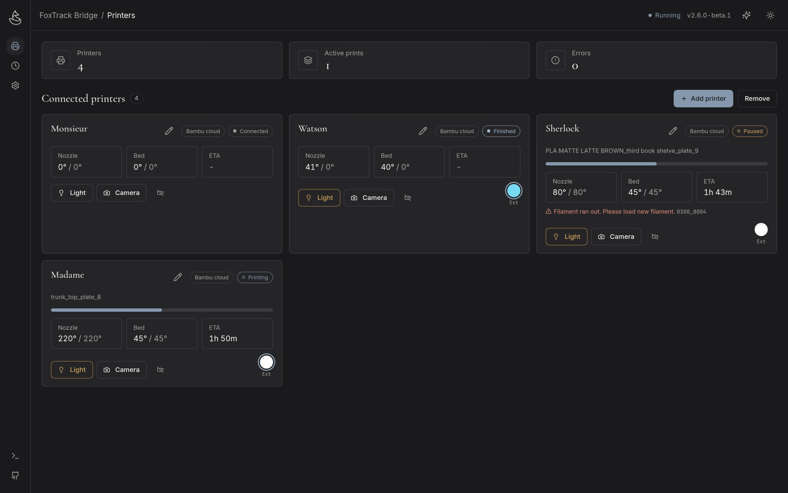
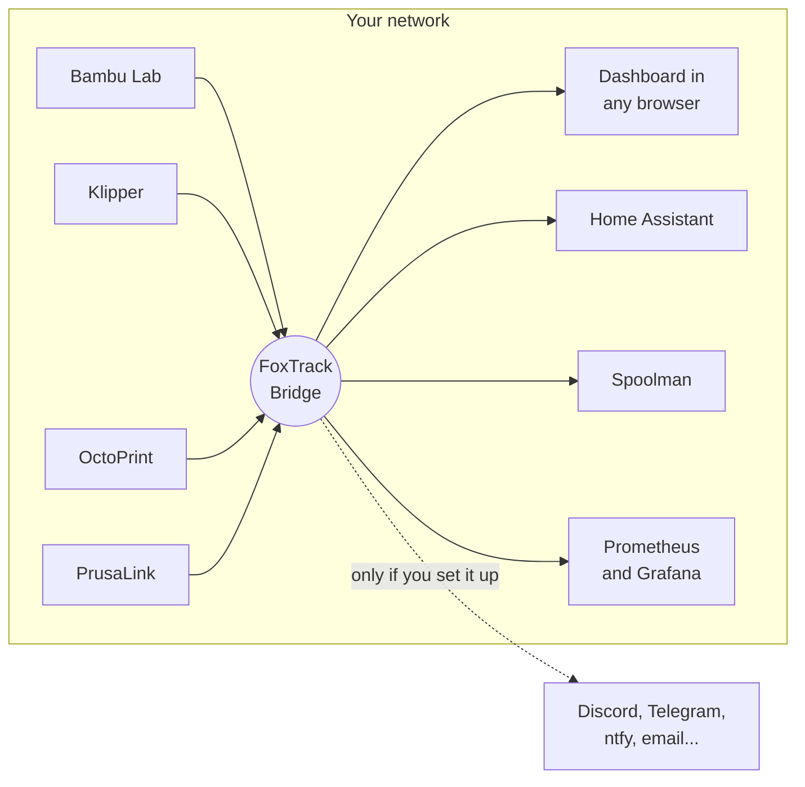
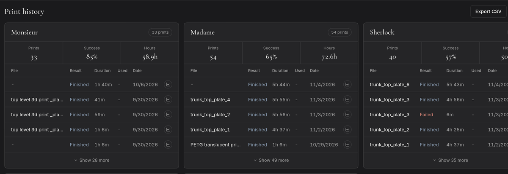
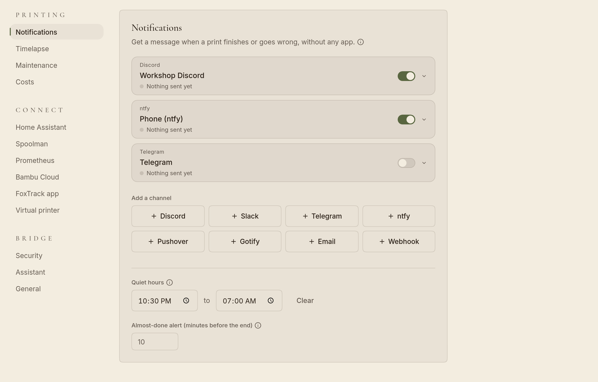
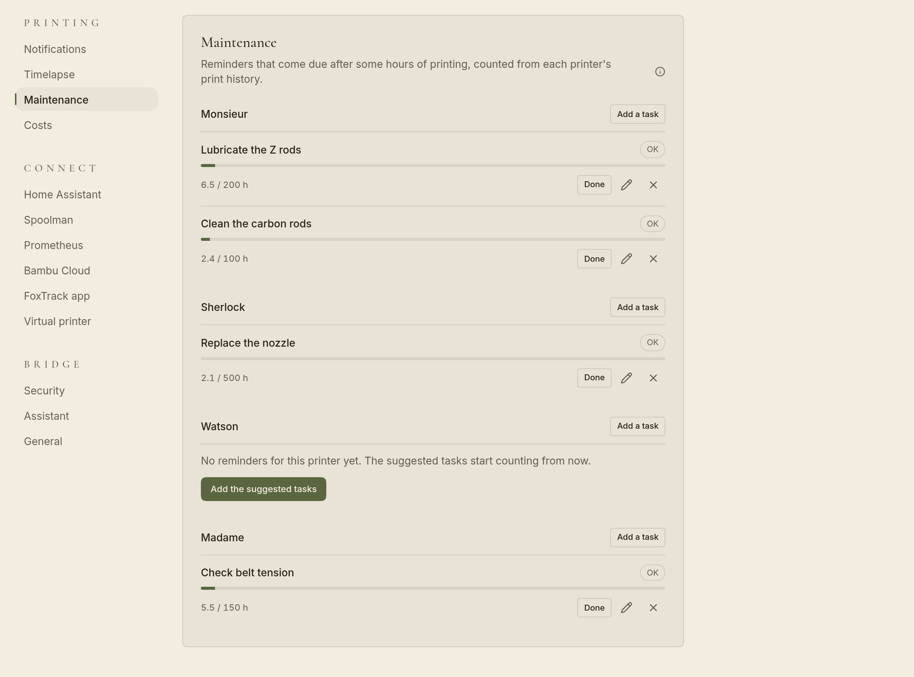
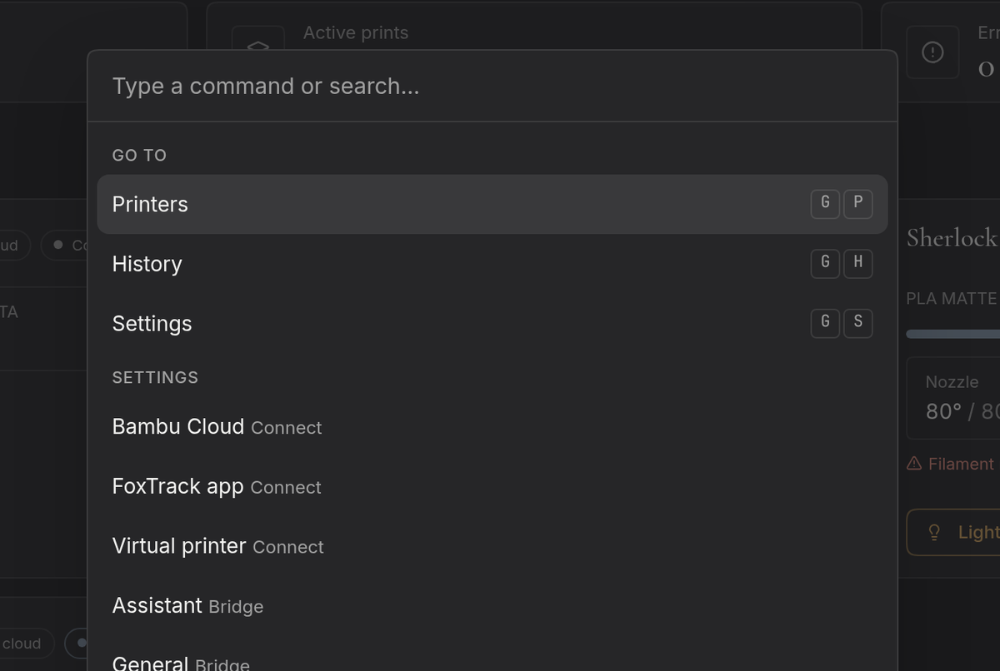
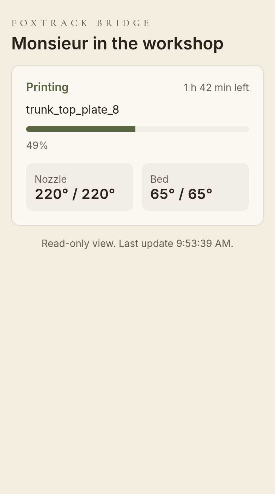
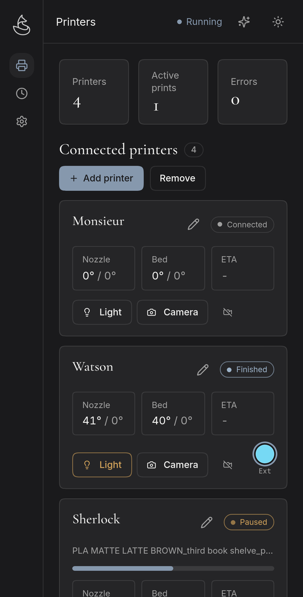

<a id="readme-top"></a>

<div align="center">

<picture>
  <source media="(prefers-color-scheme: dark)" srcset="assets/logo-dark.png">
  
</picture>

<h1>FoxTrack Bridge</h1>

<p><strong>All your 3D printers on one dashboard.</strong></p>

<p>Bambu Lab, Klipper, OctoPrint and PrusaLink side by side, with live cameras, phone alerts,<br>a print queue, timelapses and print costs. Free, open source, and it runs on your own network.</p>

[](https://github.com/FoxesRCool1/FoxTrack-Bridge/releases/latest)
[](https://github.com/FoxesRCool1/FoxTrack-Bridge/releases)
[](https://github.com/FoxesRCool1/FoxTrack-Bridge/actions/workflows/test.yml)
[](#downloads)
[](LICENSE)

<p>
  <a href="#quick-start"><strong>Quick start</strong></a> ·
  <a href="#tour">Tour</a> ·
  <a href="#printers">Printers</a> ·
  <a href="#setup-guides">Setup guides</a> ·
  <a href="https://github.com/FoxesRCool1/FoxTrack-Bridge/issues/new">Report a bug</a>
</p>



</div>

<details>
<summary><b>Table of contents</b></summary>

- [Highlights](#highlights)
- [About](#about)
- [A quick tour](#tour)
- [Printers it works with](#printers)
- [Quick start](#quick-start)
- [Downloads](#downloads)
- [Setup guides](#setup-guides)
- [What's new and known limits](#whats-new)
- [Contributing](#contributing)
- [Support the project](#support)
- [Acknowledgments](#acknowledgments)
- [License](#license)

</details>

<a id="highlights"></a>

## 🌟 Highlights

- **One dashboard for every printer.** Bambu Lab, Klipper (Moonraker), OctoPrint, PrusaLink and printers Home Assistant already knows.
- **Control, not just status.** Pause, resume, stop, temperatures, fans, speed, the light, skip a failed part, and start a file on the printer.
- **A print queue.** Line up the next files and start each one when you have cleared the bed.
- **Alerts on your phone.** Discord, Slack, Telegram, ntfy, Pushover, Gotify, email or any webhook, with a camera picture.
- **History that adds up.** Every print with its time, filament, energy, cost and your notes, exportable as CSV.
- **Share a printer.** Send someone a read-only link to watch a print, with no access to anything else.
- **Yours to keep.** No account, no subscription, no cloud. Settings are backed up every day and can be moved to another machine in one file.

<p align="right">(<a href="#readme-top">back to top</a>)</p>

<a id="about"></a>

## ℹ️ About

Most printer software only talks to one brand. If you run a Bambu next to a Voron and a Prusa, you end up with three apps, three sets of alerts and no single place to see what is printing. FoxTrack Bridge puts them in one dashboard that you host yourself. It needs no account or subscription, and nothing leaves your network unless you connect a service such as Discord or Home Assistant.

### How it fits together



The Bridge talks to each printer the way the printer prefers: MQTT for Bambu Lab, HTTP for Moonraker, OctoPrint and PrusaLink. Leave it running on an always-on computer, a NAS or a Raspberry Pi. It only records prints and sends alerts while it runs.

### Who makes it

FoxTrack Bridge is made by [@FoxesRCool1](https://github.com/FoxesRCool1), who also builds the [FoxTrack](https://foxtrack.studio/) print-farm app, together with everyone who has sent a fix, a translation or a bug report. The Bridge works fully on its own; FoxTrack is optional.

<p align="right">(<a href="#readme-top">back to top</a>)</p>

<a id="tour"></a>

## 📸 A quick tour

<table>
<tr>
<td width="50%" valign="top">

<h3>Every print, with its cost</h3>
History keeps each print's result, time, filament and energy per printer, with a note you can add. Set your prices under Costs to see what each print cost, and export it all as CSV.
</td>
<td width="50%" valign="top">

<h3>Alerts on your phone</h3>
Pick the events per channel, from print finished to "almost done". A camera picture can come along, and quiet hours still let failures through.
</td>
</tr>
<tr>
<td width="50%" valign="top">

<h3>Maintenance that keeps count</h3>
Reminders come due after hours of printing, counted from each printer's history: oil the rods, check the belts, swap the nozzle.
</td>
<td width="50%" valign="top">

<h3>Fast to drive</h3>
Press Ctrl+K (or ⌘K) to jump to any printer or setting, or to pause every printing printer at once. Press <code>?</code> for keyboard shortcuts. The dashboard speaks English, Deutsch, Español, Français, Italiano, Nederlands and Português.
</td>
</tr>
<tr>
<td width="50%" valign="top" align="center">

<h3>Share a print</h3>
A share link shows one printer's progress, temperatures and, if you allow it, a camera picture. No controls, no other printers, and you can revoke it at any time.
</td>
<td width="50%" valign="top" align="center">

<h3>Works on your phone</h3>
Open the dashboard from any device on your network, or add it to your home screen. No app to install.
</td>
</tr>
</table>

It also does:

- **Print queue.** Add files that are already on the printer from **Start a print**, reorder them on the printer's card, and press **Start next** once the bed is clear. The Bridge never starts a queued print by itself.
- **Timelapses.** A picture every few seconds while a printer prints, turned into a video when the print ends. Videos stay on your machine.
- **Skip objects.** Drop a failed part from the plate while the rest keeps printing.
- **Filament.** Set the material and colour of AMS, AMS HT and external spool slots on Bambu Lab printers in LAN mode, and track spools with Spoolman.
- **Alarms in plain words.** Bambu HMS codes with their description and a wiki link, Klipper shutdowns, PrusaLink and OctoPrint errors. A wrong access code or a printer that refuses control is explained on its card.
- **Smart plugs.** Shelly, Tasmota, TP-Link Kasa and Tapo, Tuya / Smart Life, Meross, Sonoff, ESPHome, myStrom, WiZ, or any switch in Home Assistant: see the watts, switch the printer off, or have the Bridge turn it off once a finished print has cooled.
- **Home Assistant and Grafana.** Each printer as its own device over MQTT, and Prometheus metrics.
- **An optional dashboard password and API tokens.**
- **An experimental assistant** that can tell you why a printer is offline or how a print looks, and can watch the camera for failed prints, using an AI provider you choose.
- **Automatic updates**, a tray app on Windows and macOS, and a headless mode for servers and Raspberry Pi.

<p align="right">(<a href="#readme-top">back to top</a>)</p>

<a id="printers"></a>

## 🖨️ Printers it works with

| | Live status | Camera | Pause / stop | Temps and home | Start a file and queue | Skip objects | Alarms |
|---|:-:|:-:|:-:|:-:|:-:|:-:|:-:|
| **Bambu Lab** (LAN mode) | ✓ | ✓ ¹ | ✓ | ✓ | ✓ | ✓ ² | ✓ |
| **Bambu Lab** (cloud) | ✓ | ✓ ³ | | | | | ✓ |
| **Klipper** (Moonraker) | ✓ | ✓ | ✓ | ✓ | ✓ | ✓ ⁴ | ✓ |
| **OctoPrint** | ✓ | ✓ | ✓ | ✓ | ✓ | | ✓ |
| **PrusaLink** (MK4, XL, MINI, Core One) | ✓ | ⁵ | ✓ | | | | ✓ |
| **Home Assistant** (read-only) | ✓ | | | | | | ✓ |

<sub>¹ X1, H2 and P2S need ffmpeg. ² Needs Developer Mode. ³ When the printer is on the same network. ⁴ Needs <code>[exclude_object]</code>. ⁵ A separate webcam URL.</sub>

<p align="right">(<a href="#readme-top">back to top</a>)</p>

<a id="quick-start"></a>

## 🚀 Quick start

**Windows and macOS.** Download the file from the [latest release](https://github.com/FoxesRCool1/FoxTrack-Bridge/releases/latest) and run it. The dashboard opens in your browser and an icon appears in the tray. Tick **Start at Login** in the tray menu to keep it running.

**Linux.** Install it for your user, with a systemd service that starts at login:

```bash
curl -fsSL https://raw.githubusercontent.com/FoxesRCool1/FoxTrack-Bridge/main/linux/install.sh | sh
```

**Docker.** Grab [docker-compose.yml](docker-compose.yml), then:

```bash
docker compose up -d
docker compose logs foxtrack-bridge   # shows the dashboard address
```

Then open the dashboard. The welcome screen looks for printers on your network: click **Add** next to yours and enter its access code (Bambu Lab) or API key. The Bridge tests the connection before saving and tells you what to fix if it can't sign in.

<p align="right">(<a href="#readme-top">back to top</a>)</p>

<a id="downloads"></a>

## ⬇️ Downloads

| System | File | Interface |
|---|---|---|
| Windows x64 | `FoxTrack-Bridge-Windows.exe` | Tray app |
| macOS Intel | `FoxTrack-Bridge-macOS-Intel.zip` | Tray app |
| macOS Apple Silicon | `FoxTrack-Bridge-macOS-Apple-Silicon.zip` | Tray app |
| Linux x64 | `FoxTrack-Bridge-Linux` | Headless |
| Linux ARM64 (Pi 3 or later, Pi Zero 2 W) | `FoxTrack-Bridge-Linux-ARM64` | Headless |
| Linux ARM32 (ARMv7 or later) | `FoxTrack-Bridge-Linux-ARM32` | Headless |

Each release has a `checksums.txt`. Check a download with `grep <file> checksums.txt | sha256sum -c -` (on macOS, `shasum -a 256 -c -`).

<p align="right">(<a href="#readme-top">back to top</a>)</p>

<a id="setup-guides"></a>

## 📖 Setup guides

<details>
<summary><b>Bambu Lab</b></summary>

1. On the printer, turn on **LAN Only Mode** in the network settings. The access code is shown there.
2. Turn on **Developer Mode** (next to LAN Only Mode on 2025 firmware and later, under About on older firmware). Pause, stop, printing files and skipping objects need it.
3. In the dashboard, choose **Bambu Lab (LAN mode)** and enter the IP address, serial number and access code.

The A1 and P1 series send camera pictures the Bridge reads directly. The X1, H2 and P2S series stream over RTSP, which needs [ffmpeg](https://ffmpeg.org) (`sudo apt install ffmpeg`, `brew install ffmpeg` or `winget install ffmpeg`; the Docker image already has it). Restart the Bridge after installing it, or set `FOXTRACK_BRIDGE_FFMPEG` to its full path. Liveview must be on in the printer's settings.

Printers that aren't in LAN mode can be added through your Bambu account. See **Bambu Cloud** below.

</details>

<details>
<summary><b>Klipper, OctoPrint and PrusaLink</b></summary>

**Klipper:** choose **Klipper / Moonraker** and enter the Moonraker address, usually `http://192.168.x.x:7125`. Add the API key if Moonraker has authentication turned on.

**OctoPrint:** create an API key under **Settings > Application Keys** (or copy the global key under **Settings > API**). Choose **OctoPrint** and enter the address, for example `http://octopi.local`, and the key. The webcam is read from OctoPrint's own settings.

**PrusaLink:** turn on PrusaLink in the printer's network settings. Choose **Prusa (PrusaLink)** and enter the printer's address and the API key from its PrusaLink screen. Only API key sign-in is supported (not HTTP Digest), only plain `.gcode` files can be printed (not `.bgcode`), and there is no fan control. PrusaLink has no camera stream, so enter a separate webcam URL if you have one.

The network scan finds Klipper, OctoPrint and PrusaLink on your local /24 subnet. Printers on another subnet or VLAN can be added by address.

</details>

<details>
<summary><b>A printer that Home Assistant already knows (read-only)</b></summary>

1. In Home Assistant, open your profile, then **Security**, and create a long-lived access token.
2. Find the printer's entity IDs under **Settings > Devices & services > Entities**. Only the state entity is required. Progress, temperatures, file name and time left are optional.
3. Choose **Home Assistant (read-only)** and enter the Home Assistant URL (usually `http://homeassistant.local:8123`), the token and the entity IDs.

You get status and progress, but no print controls.

</details>

<details>
<summary><b>Print queue</b></summary>

On a printer that can start a file (Bambu Lab in LAN mode, Klipper, OctoPrint), open **Start a print**, type the name of a file that is already on the printer and click **Add to queue**. The printer's card then shows **Up next** with the first file. Open the list to move files up or down or remove them.

When the printer is idle or finished, **Start next** appears. It asks whether the bed is clear, then starts the first file; the file only leaves the queue once the printer has accepted it. The Bridge never starts a queued print on its own, because a print started on a full bed crashes into the last one. The queue is kept in `queue.json` next to `config.json`, so it survives a restart.

</details>

<details>
<summary><b>Smart plugs</b></summary>

The Bridge talks to the plug over your network and never uses the maker's cloud.

| Type | What it needs |
| --- | --- |
| Shelly (Gen1 to Gen4), Tasmota | The plug's address. Any plug flashed with Tasmota works. |
| TP-Link Kasa | The address. Newer firmware also needs the TP-Link account from the Kasa app. |
| TP-Link Tapo (P100, P110, P115...) | The address and the TP-Link account from the Tapo app (case-sensitive). The plug checks the login itself; current and older Tapo firmware both work. If the login is refused, turn on Third-Party Compatibility in the Tapo app (Me, Tapo Lab). |
| Tuya / Smart Life | The address, device ID and local key ([how to get them](#getting-a-tuya-local-key)). Leave Protocol on Auto. Re-pairing the plug changes its key. |
| Meross | The address. Leave the key blank: most plugs answer without it. Models that encrypt their local traffic need the Meross key ([how to get it](#getting-a-meross-key)) and the plug's MAC address (found automatically on Linux). |
| Sonoff | The address, with the plug in DIY mode (firmware 3.5+; see Itead's DIY instructions for your model). DIY mode reports no watts: for those, flash Tasmota or ESPHome, or use Home Assistant. |
| ESPHome (e.g. Athom) | The address, with `web_server:` in the device YAML. The relay and power sensor are found automatically. |
| myStrom | The address, plus the API token if you secured the plug with one. |
| WiZ | The address, with "Allow local communication" on in the WiZ app. With Docker, use host networking (WiZ uses UDP). |
| Home Assistant | Your Home Assistant URL, a long-lived access token (profile, Security, Long-lived access tokens) and the switch entity, plus a power sensor entity for watts. Covers Zigbee, Matter, Hue and anything else Home Assistant can switch. |

Plugs without a lifetime energy counter (Tapo, Tuya, Meross, ESPHome, myStrom, WiZ, Home Assistant) still get each print's energy, from the watts over time.

#### Getting a Tuya local key

The key only comes from Tuya's cloud, so you fetch it once on any computer with Python:

1. Sign up at [iot.tuya.com](https://iot.tuya.com), create a Cloud project (Smart Home) in the data center of your Smart Life account, and link the Smart Life app to it (Devices, Link App Account, scan the QR code with the app).
2. Run `pip install tinytuya`, then `python -m tinytuya wizard`, and give it the project's Access ID and Access Secret.
3. Copy the plug's `id` (Device ID) and `key` (Local key) from the list it prints.

A Tuya plug answers one local connection at a time, so close Home Assistant's Local Tuya or tinytuya if **Check plug** cannot reach it.

#### Getting a Meross key

Only encrypted Meross models need it. Home Assistant's meross_lan shows it, or run once:

```bash
pip install meross_iot
python -c "import asyncio; from meross_iot.http_api import MerossHttpClient as C; print(asyncio.run(C.async_from_user_password(api_base_url='https://iotx-eu.meross.com', email='YOUR EMAIL', password='YOUR PASSWORD')).cloud_credentials.key)"
```

Click the pencil on a printer's card, scroll to **Smart plug**, choose the type, enter the plug's address and click **Check plug**. With **Turn off after a print** ticked, the plug switches off a set number of minutes after a print ends, once the nozzle is below 50 °C. A new print in that time cancels it. The off button is disabled while the printer is printing or hot. **Turn off idle plugs** in the command menu does the same for every idle printer at once.

</details>

<details>
<summary><b>Notifications</b></summary>

Add channels under **Settings > Notifications**. Each one picks its printers and its events: print started, almost done, paused, resumed, finished, failed, cancelled, a failure spotted by the camera watch, printer alarm (and alarm cleared), offline, back online and maintenance due. A channel can attach a camera picture. **Send test** checks a channel before you save it. During quiet hours only failures and errors are sent.

**Almost done** is off until you tick it on a channel. It is sent once per print when the time left drops to the minutes set under **Almost-done alert** (10 by default), and only past the halfway point, so an early estimate can't trigger it.

| Service | What you need |
|---|---|
| Discord | A webhook URL (Server settings > Integrations > Webhooks) |
| Slack | An incoming webhook URL |
| Telegram | A bot token from @BotFather and your chat ID |
| ntfy | A topic URL on ntfy.sh or your own server, and an access token if the topic is protected |
| Pushover | An application token and your user key |
| Gotify | The server address and an application token |
| Email | An SMTP server, port, username, password and recipient |
| Webhook | Any URL that accepts a JSON POST (Node-RED, n8n, Home Assistant) |

Messages go straight from the Bridge to the service. Tokens and passwords are saved in `config.json` and never shown again in the dashboard.

</details>

<details>
<summary><b>Timelapse</b></summary>

Turn on **Settings > Timelapse** to take a picture every few seconds while a printer prints. When the print ends the pictures become an MP4 (or an animated GIF without ffmpeg). Videos are kept for 30 days by default, and you can watch, download and delete them on the same page.

</details>

<details>
<summary><b>Home Assistant and Prometheus</b></summary>

**Settings > Home Assistant** connects the Bridge to your MQTT broker (the Mosquitto add-on works). With discovery on, each printer appears under **Settings > Devices & services > MQTT** with its status, progress, temperatures, time left and pause, resume, stop and light buttons. State is published to `foxtrack_bridge/<printer id>/state` and events to `foxtrack_bridge/<printer id>/event`, so any MQTT client can use them.

**Settings > Prometheus** turns on `/metrics`: printer up, printing, progress, temperatures, time left, alarms, job counts, print time and energy. With a dashboard password set, create an API token and send it as a bearer token:

```yaml
scrape_configs:
  - job_name: foxtrack-bridge
    static_configs:
      - targets: ["192.168.1.20:8080"]
    authorization:
      credentials: ftk_your_token
```

</details>

<details>
<summary><b>Password, API tokens and share links</b></summary>

Out of the box, anyone on your network can open the dashboard and control your printers, as with most printer interfaces. Set a password under **Settings > Security** and every page and API call then needs a signed-in browser or an API token (`Authorization: Bearer ftk_...`). Passwords are stored as salted PBKDF2 hashes and tokens as SHA-256 hashes. After five wrong passwords, sign-in slows down.

**Share links**, on the same page, give one person a read-only view of one printer: its progress, time left, temperatures and, if you tick **Show the camera**, a camera picture that refreshes every 10 seconds. The link works without the password, for anyone who can reach the Bridge's address, and shows nothing else: no controls, no other printers, no addresses or codes. Like API tokens, a link is shown once when you make it and only its hash is stored. **Revoke** stops it at once, and removing the printer stops it too.

To reset a forgotten password, stop the Bridge, run it once with `--reset-password`, then start it again. API tokens are kept. On Windows and macOS, quit from the tray first and run it from a terminal. With Docker: `docker compose stop`, `docker compose run --rm foxtrack-bridge --reset-password`, `docker compose up -d`.

</details>

<details>
<summary><b>Bambu Cloud (experimental)</b></summary>

Bambu printers that aren't in LAN mode can be added through your Bambu account. Open **Settings > Bambu Cloud**, sign in with your Bambu email and password, and enter the code Bambu emails you. Then add a printer of type **Bambu Lab (cloud, experimental)** and pick it from the list.

Status, temperatures, progress, AMS, the light and smart plugs work. The camera works when the printer is on the same network as the Bridge. Pause, stop, speed, fan and GCode don't: Bambu's 2025 and later firmware rejects every command except the light from third-party software, so those buttons are hidden.

Bambu bans accounts for 24 hours to 7 days when it sees too many connections, so the Bridge keeps one MQTT connection for the whole account, backs off from 5 seconds to 5 minutes between reconnects, waits 30 minutes after 10 failures, never signs in by itself, and asks each printer for its full status at most once a minute. Tokens last about 90 days and the dashboard warns you a week before. If Cloudflare blocks sign-in, **Use a token instead** accepts a token from a signed-in Bambu session. Details: [docs/bambu-cloud.md](docs/bambu-cloud.md).

</details>

<details>
<summary><b>Assistant and camera failure watch (experimental)</b></summary>

The assistant (the sparkle button in the top bar) answers questions about your printers from live status, print history and the Bridge log. It walks you through adding a printer, works out why a printer won't connect, and can look at a camera picture to spot a warped or detached print.

It is off until you add an AI provider under **Settings > Assistant**, and you pay that provider. Anything that speaks the OpenAI chat completions API works: OpenAI, Google Gemini, Anthropic, a custom endpoint, or a local server such as Ollama (`http://localhost:11434/v1`). Requests go straight from the Bridge to the provider, and conversations are not saved.

The assistant can only read. It can't change printers, control prints or change settings, and it says when it doesn't know. Access codes, API keys and tokens are removed from log lines before it sees them. Camera access is a separate switch, off by default; with a cloud provider it sends pictures of your printer to that provider. Without a dashboard password, anyone on your network can use the assistant and spend credit on your key.

**Watch prints for failures** (it needs camera access) has the assistant look at each printing printer's camera every few minutes (5 by default, 2 to 60) once the first 5 minutes of a print have passed. When two checks in a row look like a failed print (spaghetti, a part knocked loose, a blob on the nozzle), every notification channel that has **Failure spotted by camera watch** ticked gets one message for that print. It never pauses or stops a print: a model can be wrong, so you decide. Each check sends a picture to your provider, which can cost money with a paid one; a local model costs nothing. Use a model that can read images.

</details>

<details>
<summary><b>Back up, restore and move to another machine</b></summary>

**Settings > General > Back up and restore** downloads your printers and settings as one file, and restores them from it. The file holds no passwords, tokens or keys: not your FoxTrack tokens, printer access codes, plug, notification or MQTT secrets, dashboard password, API tokens, linked Bambu account or assistant key. Share links are not in it either. A restore never changes the dashboard password, API tokens, share links and Bambu account, and keeps the access codes, tokens and keys already saved for the same printers, channels and broker (the assistant key only when the backup uses the same AI provider). On a new machine, enter them again. With no dashboard password set, backup and restore work only on the computer the Bridge runs on; from another device, set a password first. Before a restore, the current settings are saved next to `config.json` as `config.json.before-import-<date>`.

The Bridge also keeps a daily copy of `config.json` and `history.json` in a `backups` folder next to them, and keeps the last 7 of each. **Restore from file** accepts those copies too.

</details>

<details>
<summary><b>Running on Linux without the installer</b></summary>

Keep the binary somewhere your own account can write to, so automatic updates work:

```bash
mkdir -p ~/.local/bin
mv FoxTrack-Bridge-Linux-ARM64 ~/.local/bin/foxtrack-bridge
chmod +x ~/.local/bin/foxtrack-bridge
```

As a systemd user service:

```bash
mkdir -p ~/.config/systemd/user
curl -fsSL -o ~/.config/systemd/user/foxtrack-bridge.service \
  https://raw.githubusercontent.com/FoxesRCool1/FoxTrack-Bridge/main/linux/foxtrack-bridge-user.service
systemctl --user enable --now foxtrack-bridge
loginctl enable-linger "$(whoami)"   # keep it running after you log out
```

As a system service under a dedicated account:

```bash
sudo cp FoxTrack-Bridge-Linux-ARM64 /usr/local/bin/foxtrack-bridge
sudo cp linux/foxtrack-bridge@.service /etc/systemd/system/
sudo systemctl daemon-reload
sudo systemctl enable --now foxtrack-bridge@<username>
```

A binary in `/usr/local/bin` belongs to root, so a non-root service account can't update it. The dashboard then shows a download link instead of **Update now**. `linux/install.sh --uninstall` removes an installer setup and keeps your settings.

To reach the dashboard from another device, open the port in your firewall (`sudo ufw allow 8080/tcp`, or `firewall-cmd --permanent --add-port=8080/tcp`), and check your router's AP or client isolation if it still can't connect.

</details>

<details>
<summary><b>Docker details</b></summary>

The compose file runs `ghcr.io/foxesrcool1/foxtrack-bridge` with `network_mode: host`, because Bambu discovery relies on SSDP broadcasts that don't cross Docker's default network. With host networking `ports:` is ignored, so set `FOXTRACK_BRIDGE_PORT` to change the port. On Docker Desktop (Windows, macOS), add printers by address if discovery finds nothing. Settings and history live in the `foxtrack-bridge-data` volume.

The Bridge can't update itself inside Docker; run `docker compose pull && docker compose up -d`. [docs/docker.md](docs/docker.md) covers building your own image.

</details>

<details>
<summary><b>Settings files and port</b></summary>

`config.json`, `history.json` and `queue.json` live in `~/.config/FoxTrack-Bridge/` on Linux (or `$XDG_CONFIG_HOME/FoxTrack-Bridge`), `~/Library/Application Support/FoxTrack-Bridge/` on macOS and `%AppData%\FoxTrack-Bridge\` on Windows, with the daily copies in `backups/` next to them. If a file is damaged, the Bridge keeps it as `<name>.corrupt-<timestamp>` and starts fresh. It never deletes it.

The Bridge listens on port 8080. Change it with `--port 9000` or `FOXTRACK_BRIDGE_PORT=9000`; the flag wins if both are set. On Klipper machines 8080 is also the usual webcam port for Mainsail and Fluidd, so move one of them.

</details>

<details>
<summary><b>Building from source</b></summary>

You need Go 1.26 or later. Always set the version, otherwise update checks are turned off:

```bash
# Linux, headless
CGO_ENABLED=0 go build -tags headless -ldflags="-s -w -X foxtrack-bridge/version.AppVersion=<version>" -o foxtrack-bridge ./cmd/foxtrack-bridge

# Windows and macOS with the tray (needs CGO and a C toolchain)
go build -ldflags="-s -w -X foxtrack-bridge/version.AppVersion=<version>" -o foxtrack-bridge ./cmd/foxtrack-bridge

# Tests (the headless tag is required, or most tests are skipped)
go test -tags headless ./...
node --test web/tests/
```

A Linux build with the tray needs `gcc`, `libgtk-3-dev` and `libayatana-appindicator3-dev`. For a Raspberry Pi, add `GOOS=linux GOARCH=arm64` (or `GOARCH=arm GOARM=7` for 32-bit).

The dashboard is `web/ui.html` plus one script per feature in `web/features/`. Translations live in `web/i18n/`, keyed by the English text: run `python3 scripts/i18n-extract.py . web/i18n/_source.json` after changing text, then `python3 web/i18n/_check.py`. Styles, fonts and icons are committed under `web/` and built into the binary, so nothing is downloaded at build time or run time. Colours come from the tokens in `web/ui.html`; never put a Tailwind palette colour or a hex value in the markup (the tests check). After changing classes, regenerate Tailwind with the standalone CLI:

```bash
curl -sL -o web/tailwindcss https://github.com/tailwindlabs/tailwindcss/releases/download/v3.4.17/tailwindcss-linux-x64
chmod +x web/tailwindcss
./web/tailwindcss -c web/tailwind.config.js -i web/tailwind.input.css -o web/tailwind.css --minify
```

</details>

<details>
<summary><b>Using it with the FoxTrack app</b></summary>

The Bridge works on its own. If you also use the [FoxTrack](https://foxtrack.studio/) print-farm app, you can link the two under **Settings** to see your printers in FoxTrack from anywhere. [docs/foxtrack.md](docs/foxtrack.md) explains how.

</details>

<p align="right">(<a href="#readme-top">back to top</a>)</p>

<a id="whats-new"></a>

## 🗺️ What's new and known limits

New since the last release (full list in the [changelog](CHANGELOG.md)):

- [x] Print queue with **Start next**
- [x] Read-only share links
- [x] Back up and restore, and daily copies of the settings and history
- [x] "Almost done" notification
- [x] Camera failure watch (experimental)
- [x] Notes on prints in History
- [x] Bulk pause, resume and plug off from the command menu
- [x] Add the dashboard to a phone's home screen
- [x] Set the filament of AMS HT slots and both external spools of an H2D
- [x] More smart plugs: Tapo, newer Kasa, Tuya, Meross, Sonoff, ESPHome, myStrom, WiZ and Home Assistant

Known limits:

- **Bambu Cloud printers** can't be paused, stopped or sent files. Bambu's firmware refuses those commands from third-party software, so use LAN mode with Developer Mode for full control.
- **PrusaLink** has no fan control, can't print `.bgcode` files and only supports API key sign-in.
- **Home Assistant printers** are read-only.
- **Docker** installs update with `docker compose pull`, not from the dashboard.

Something missing? [Open an issue](https://github.com/FoxesRCool1/FoxTrack-Bridge/issues/new) and say what you'd use it for.

<p align="right">(<a href="#readme-top">back to top</a>)</p>

<a id="contributing"></a>

## 🤝 Contributing

FoxTrack Bridge is a community project, and pull requests are very welcome. Support for another printer or plug, a fix for something that annoyed you, a better translation, or a clearer sentence in these docs all make it better for everyone.

1. For something bigger than a small fix, [open an issue](https://github.com/FoxesRCool1/FoxTrack-Bridge/issues/new) first so we can agree on the approach before you put the time in.
2. Fork the repository and make your change.
3. Run `go test -tags headless ./...` and `node --test web/tests/` (see **Building from source** above).
4. Open a pull request.

If you found a bug, include your printer model, the Bridge version and what the Bridge log showed (the terminal icon at the bottom left of the dashboard).

<a href="https://github.com/FoxesRCool1/FoxTrack-Bridge/graphs/contributors"></a>

<p align="right">(<a href="#readme-top">back to top</a>)</p>

<a id="support"></a>

## 💖 Support the project

FoxTrack Bridge is free and open source. If it's useful to you, you can support its development on Ko-fi.

<a href="https://ko-fi.com/foxesrcool"></a>

<p align="right">(<a href="#readme-top">back to top</a>)</p>

<a id="acknowledgments"></a>

## 🙏 Acknowledgments

- [Inter](https://rsms.me/inter/) and [Cormorant Garamond](https://github.com/CatharsisFonts/Cormorant) for the type, and [Lucide](https://lucide.dev) for the icons.
- Bambu Lab's published HMS error texts, which turn printer codes into plain words.
- [Eclipse Paho MQTT](https://github.com/eclipse/paho.mqtt.golang) and [systray](https://github.com/getlantern/systray).
- [Tailwind CSS](https://tailwindcss.com) for the dashboard's styles.

The font, icon and error-text licenses are in [THIRD_PARTY_LICENSES.md](THIRD_PARTY_LICENSES.md).

<a id="license"></a>

## 📄 License

[MIT](LICENSE).

<p align="right">(<a href="#readme-top">back to top</a>)</p>
